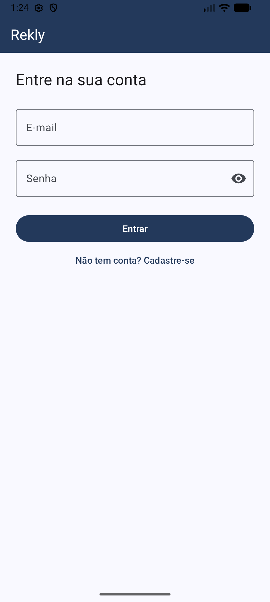
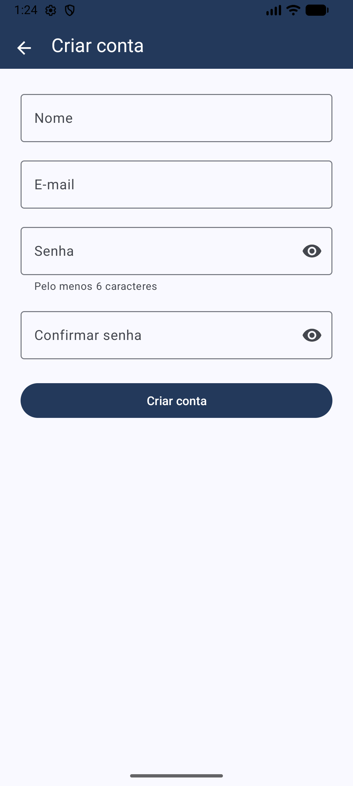
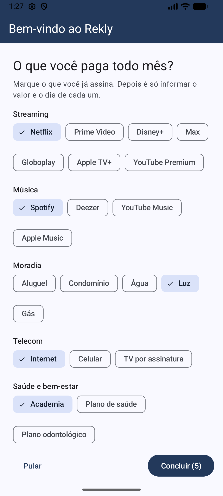
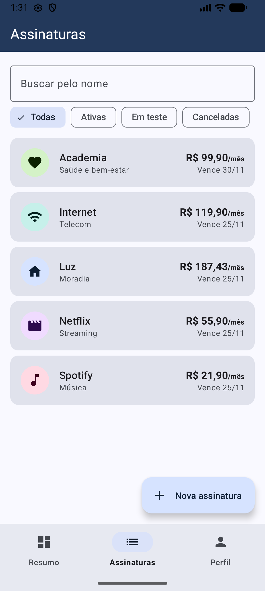
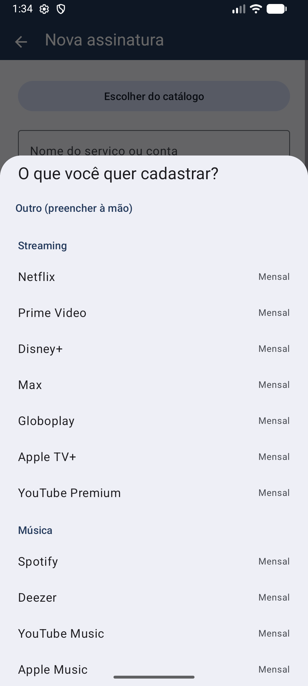
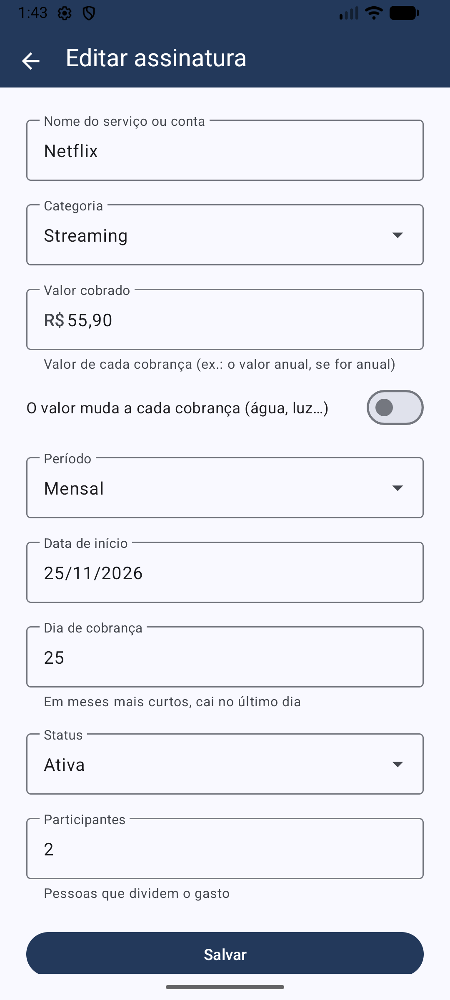
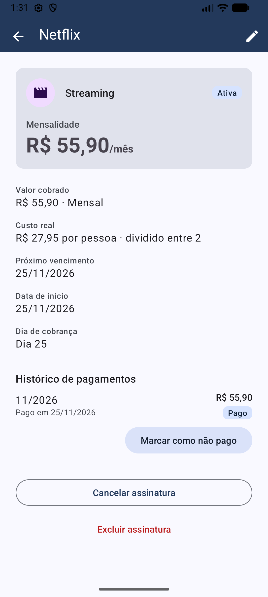
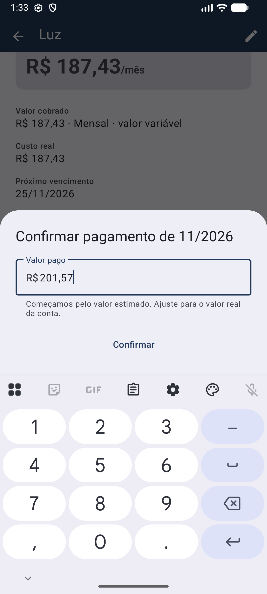
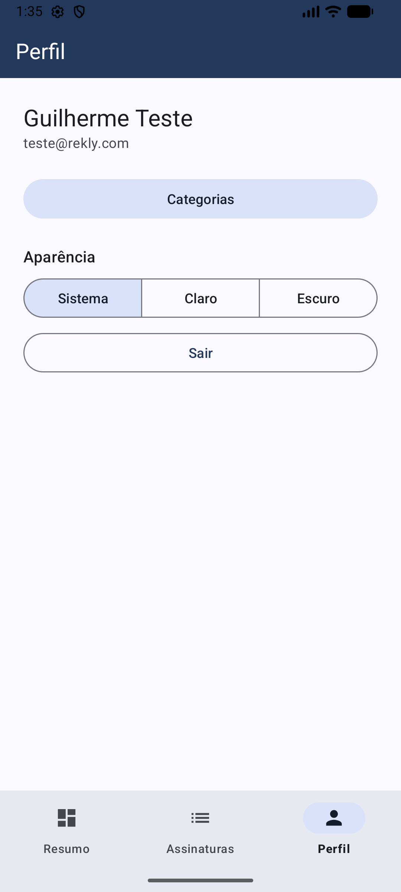
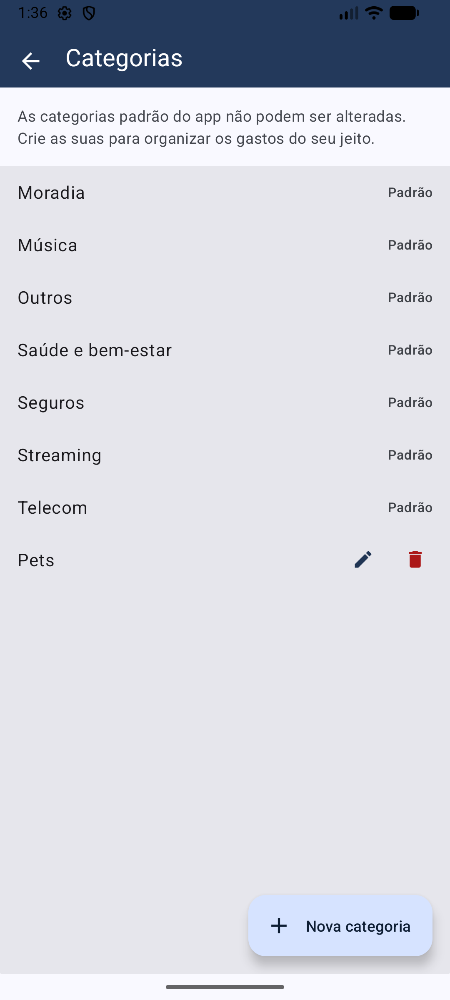

# Rekly

Projeto Final da disciplina **Desenvolvimento Mobile II**.

**Integrantes:** Guilherme S. Machado (196890) e Murilo K. Klein (199121)

## Descrição

Aplicação mobile para gerenciamento de gastos recorrentes, permitindo que usuários acompanhem assinaturas, contas e outras despesas periódicas em um único lugar.

O Rekly reúne serviços como Netflix e Spotify e contas como aluguel, água e luz, mostra quanto se gasta por mês e o custo real de cada um (quando o gasto é dividido com outras pessoas) e avisa o que vence nos próximos dias. Os pagamentos de valor fixo são registrados sozinhos a cada vencimento; os de valor variável, como a conta de luz, ficam pendentes até o usuário confirmar o valor real.

É a versão mobile do [Rekly web](https://github.com/muriloklein/rekly). Todos os dados ficam no próprio aparelho, sem servidor.

### Funcionalidades

- **Conta local:** cadastro e login com senha protegida por hash SHA-256 com salt; a sessão continua ao reabrir o app.
- **Primeiro acesso:** checklist com serviços comuns para cadastrar várias assinaturas de uma vez.
- **Assinaturas (CRUD):** criar a partir de um catálogo de 28 serviços e contas ou à mão, listar com busca e filtro por situação, ver o detalhe, editar, cancelar e excluir (bloqueado quando já há pagamentos).
- **Categorias (CRUD):** 7 categorias padrão e categorias próprias, com nome único e exclusão bloqueada se estiverem em uso.
- **Pagamentos:** gerados ao abrir o app para cada mês que venceu, sem duplicar; contas variáveis ficam pendentes até a confirmação, com ajuste do valor; histórico por assinatura.
- **Resumo:** total por mês, custo real após o rateio, assinaturas em teste à parte, vencimentos dos próximos 7 dias, pendentes a confirmar, gasto por categoria e sugestões de economia.
- **Tema** claro, escuro ou do sistema.

## Tecnologias

| Área | Tecnologias |
|---|---|
| Linguagem e plataforma | Kotlin, Android SDK (minSdk 24 / Android 7.0, targetSdk 36), Android Gradle Plugin 9.2 com Kotlin embutido |
| Interface | Layouts XML, ViewBinding, Material Components 3, ConstraintLayout, RecyclerView, Activities e Fragments |
| Arquitetura | MVVM com ViewModel, LiveData e Coroutines |
| Persistência | Room (SQLite) com KSP, migrações automáticas e schema exportado em `app/schemas` |
| Datas | `java.time` com core library desugaring (para funcionar a partir do Android 7.0) |
| Testes | JUnit 4: 123 testes unitários das regras de negócio |
| Versionamento | Git e GitHub, branches `main` e `develop`, Conventional Commits |

## Instruções de execução

### Pré-requisitos

- **Android Studio** em versão recente, compatível com o Android Gradle Plugin 9.2 (se o Studio for antigo, ele mesmo avisa que precisa atualizar).
- **JDK 21**: o Gradle baixa sozinho na primeira execução, se não estiver instalado.
- Um **emulador** (Android 7.0 ou superior) ou um celular com a depuração USB ativada.

### Rodar o app

1. Clone o repositório:
   ```bash
   git clone https://github.com/muriloklein/rekly_mobile.git
   ```
2. No Android Studio, abra a pasta `rekly_mobile` (**File > Open**) e aguarde o sync do Gradle terminar.
3. Escolha o emulador ou o aparelho e clique em **Run** (Shift+F10).
4. No primeiro acesso, toque em **"Não tem conta? Cadastre-se"** e crie uma conta. Não há conta de teste pronta: cada aparelho tem seu próprio banco.

### Rodar os testes

```bash
./gradlew testDebugUnitTest
```

No Windows, use `gradlew.bat testDebugUnitTest`. No Android Studio, clique com o botão direito em `app/src/test` e escolha **Run 'Tests in rekly'**. O relatório fica em `app/build/reports/tests/testDebugUnitTest/index.html`.

### Ver o banco de dados

Com o app rodando pelo Android Studio, abra **View > Tool Windows > App Inspection** e a aba **Database Inspector** para ver as tabelas `users`, `categories`, `subscriptions` e `payments`.

## Arquitetura

O app segue MVVM, sempre no mesmo fluxo:

```
Activity / Fragment  →  ViewModel  →  Repository  →  DAO (Room)  →  SQLite
```

- As telas não acessam o banco: só observam o `LiveData` do ViewModel, então as listas se atualizam sozinhas quando um dado muda.
- O ViewModel guarda o estado da tela, o que mantém os formulários preenchidos ao girar o aparelho.
- As regras de negócio (mensalidade, custo real, vencimentos, geração de pagamentos, validações e sugestões) são funções puras em `domain/rules`, sem dependência do Android, e por isso são testadas com JUnit.

```
com.example.rekly
├── data
│   ├── entity       → User, Category, Subscription, Payment
│   ├── local        → AppDatabase, DAOs, Converters, categorias padrão
│   └── repository   → um repositório por entidade
├── domain
│   ├── model        → enums (período, status) e erros de regra
│   ├── catalog      → catálogo de serviços e contas
│   └── rules        → cálculos, validações, pagamentos, senha e sugestões
├── ui
│   ├── auth         → Login e Cadastro
│   ├── onboarding   → primeiro acesso
│   ├── main         → tela principal com as abas Resumo, Assinaturas e Perfil
│   ├── subscription → formulário, detalhe, catálogo e confirmação de pagamento
│   └── category     → categorias
└── util             → sessão, tema, formatação de moeda e data
```

### Telas

O app tem 7 Activities e 3 Fragments:

| Tela | Tipo | O que faz |
|---|---|---|
| Login | Activity | Entrar na conta |
| Cadastro | Activity | Criar conta |
| Onboarding | Activity | Escolher os serviços que já usa no primeiro acesso |
| Principal | Activity | Hospeda as abas e o botão de nova assinatura |
| Resumo | Fragment | Totais, vencimentos, pendentes, categorias e sugestões |
| Assinaturas | Fragment | Lista com busca e filtro |
| Perfil | Fragment | Dados do usuário, categorias, tema e sair |
| Formulário de assinatura | Activity | Criar (com catálogo) e editar |
| Detalhe da assinatura | Activity | Dados, histórico de pagamentos, cancelar e excluir |
| Categorias | Activity | Criar, renomear e excluir categorias |

O plano completo do projeto, com regras de negócio, modelo de dados e divisão de tarefas, está em [`rekly-mobile-plano-projeto-final.md`](rekly-mobile-plano-projeto-final.md).

## Prints das telas

Os prints ficam na pasta [`prints/`](prints/).

| | | |
|:---:|:---:|:---:|
| <br>Login | <br>Cadastro | <br>Onboarding |
| <br>Resumo | <br>Assinaturas | <br>Catálogo |
| <br>Formulário | <br>Detalhe | <br>Confirmar pagamento |
| <br>Perfil | <br>Categorias | <br>Tema escuro |

## Git

- `main` recebe só versões estáveis, por merge da `develop` ao fim de cada etapa.
- `develop` é onde o desenvolvimento acontece, com commits dos dois integrantes.
- As mensagens seguem o padrão **Conventional Commits**, em português (ex.: `feat(assinaturas): adiciona formulário de criação e edição`).
